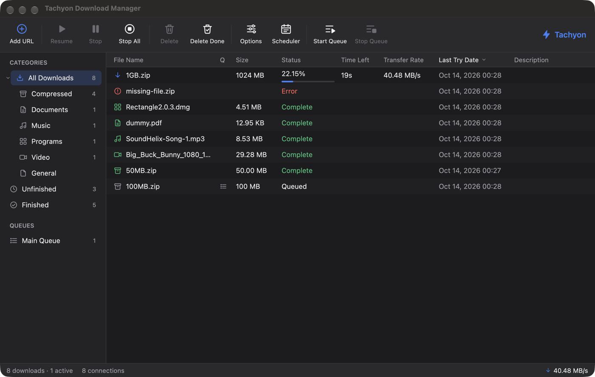
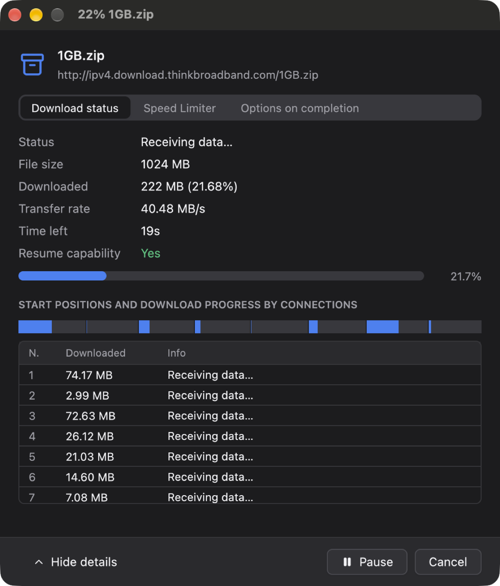
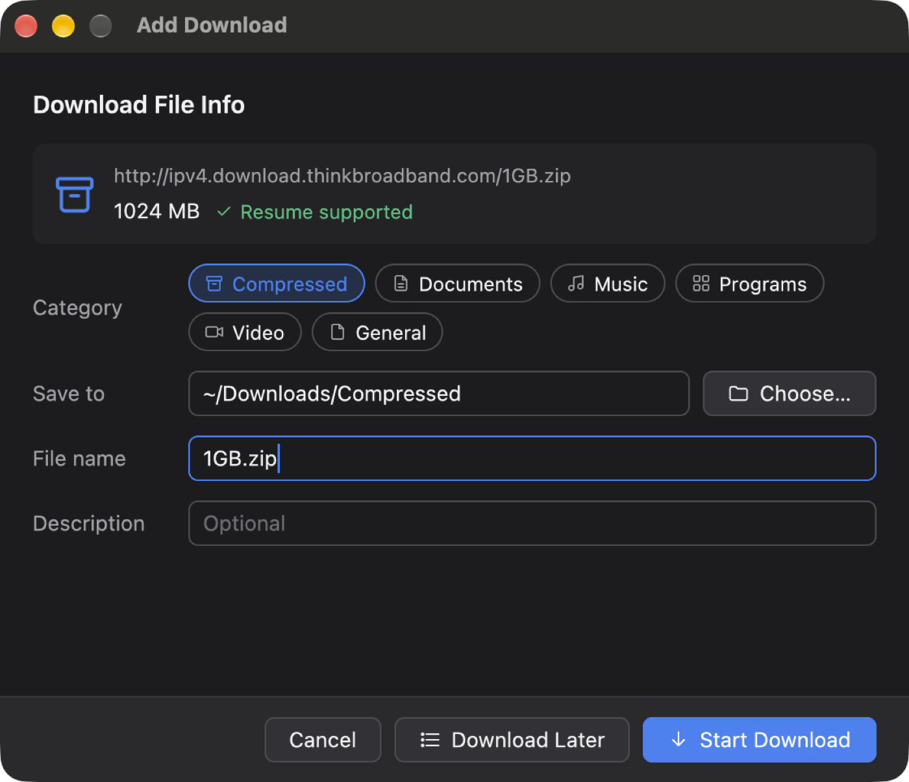
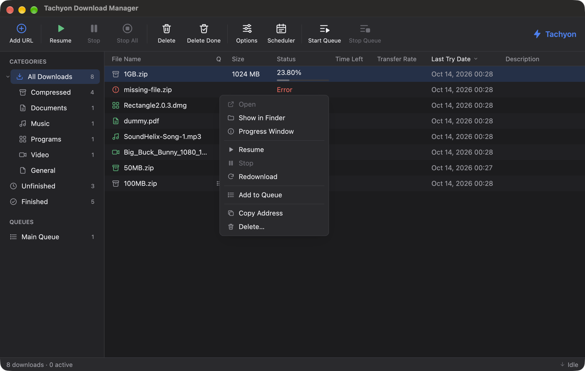
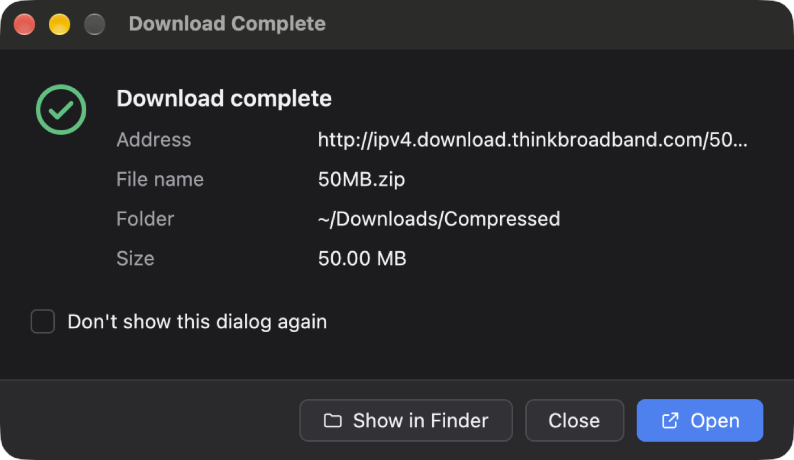
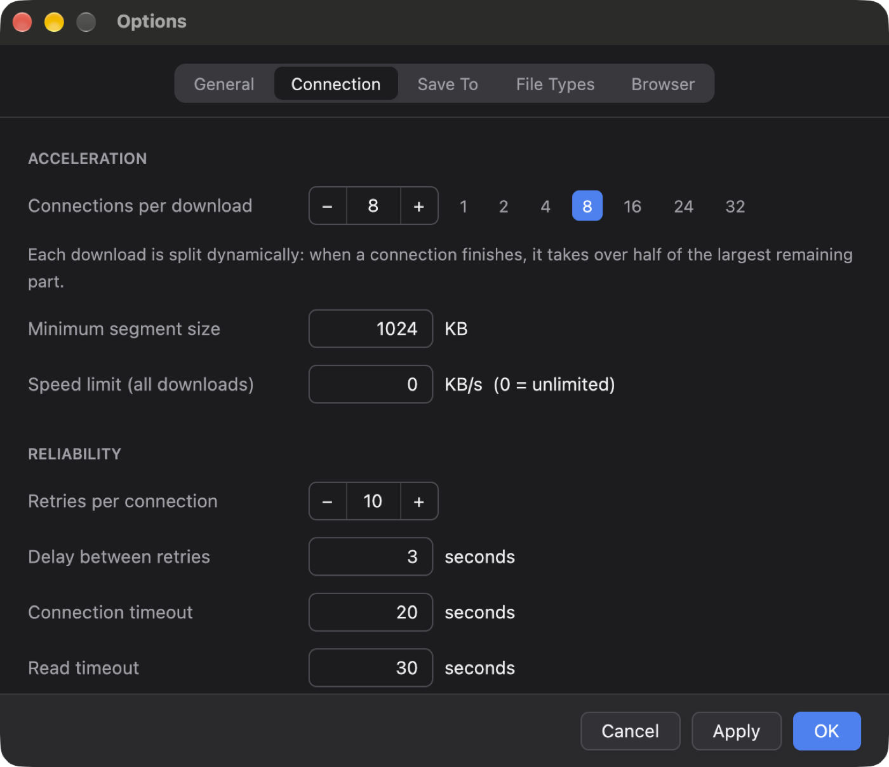
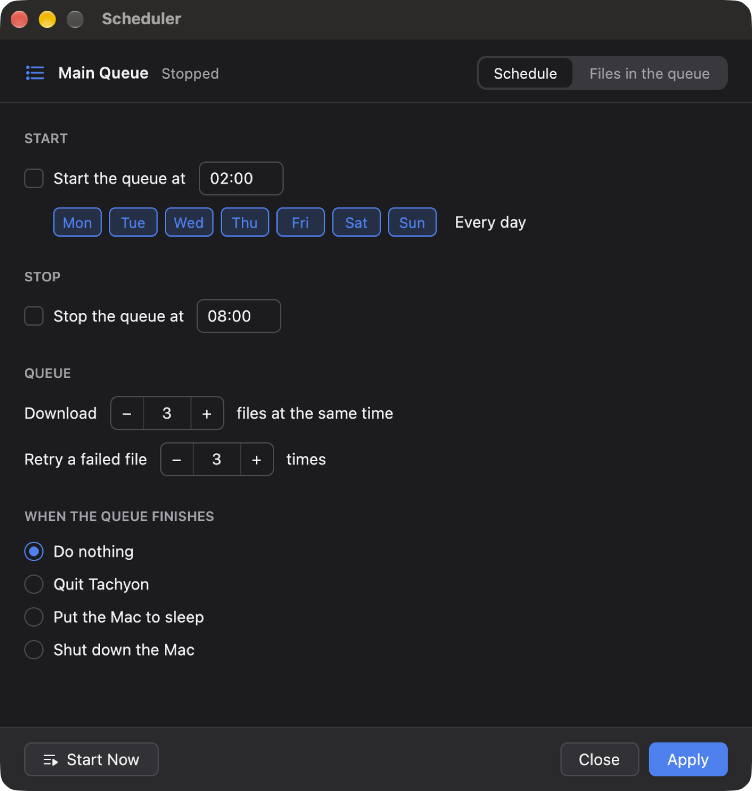

<p align="center"></p>

# Tachyon Download Manager

A native macOS download accelerator modelled on **Internet Download Manager (IDM)**,
written in Rust with [GPUI](https://www.gpui.rs) (the GPU-accelerated UI framework
behind the Zed editor).



| Progress window with the live segment map | Download File Info |
| --- | --- |
|  |  |

| Context menu | Download complete |
| --- | --- |
|  |  |

| Options → Connection | Scheduler |
| --- | --- |
|  |  |

## Features

- **Dynamic file segmentation.** A download starts on one connection. Every free
  connection then takes over half of the largest remaining segment, up to 32 connections
  (8 by default). On a real 1 GB file it reached 40.5 MB/s.
- **Connection reuse.** The connection that probes the server keeps streaming as the first
  segment. A connection that finishes its segment picks up leftover or newly split work
  instead of closing.
- **Resume anywhere.** Segment positions are saved every two seconds and on quit. After a
  pause, crash or reboot, only the missing bytes are fetched. ETag and Last-Modified are
  checked, and the download restarts if the file changed on the server.
- **Polite to servers.** Connections ramp up gradually. HTTP 429/503 and connections that
  never get an answer lower the connection cap, `Retry-After` is honoured, and retries use
  exponential backoff with jitter.
- **Speed limiter**, per download and globally (token bucket).
- **Main queue and scheduler.** Start and stop times, days of the week, N files at a time,
  retries for failed files, and what to do when it finishes: nothing, quit, sleep or shut
  down, with a 30-second cancel countdown.
- **Automatic categories** (Compressed, Documents, Music, Programs, Video, General). Each
  category has editable extensions and its own folder.
- **Browser integration.** A Manifest V3 extension for Chromium browsers and Firefox adds
  *Download with Tachyon* to context menus and can take over matching browser downloads,
  passing the referrer and cookies along.
- **IDM's dialogs.** Add URL → Download File Info, a progress window (status, speed
  limiter, completion options, per-connection table), Download Complete, Options and
  Scheduler.
- Basic authentication, proxies (system, HTTP or SOCKS5), clipboard monitoring, light and
  dark mode, and keyboard shortcuts (⌘N, ⌘R, ⌘., ⌫, ⌘A, ⌘,).

## How IDM was analysed

The brief was to reverse-engineer IDM and build an equivalent. IDM is a closed-source
Windows program whose licence forbids disassembly, and its binaries would not run on macOS
anyway. So this is a **clean-room, behavioural** analysis: only public documentation and
observable behaviour were used, and no IDM code or binaries. Tachyon is not affiliated with
or endorsed by Tonec Inc.

| IDM behaviour (source) | Tachyon implementation |
| --- | --- |
| "Dynamic file segmentation": files are split *during* the download. When a connection is free, the largest remaining part is halved and the new connection takes the second half ([features page][f]). | `SegmentMap::split_largest`, `crates/engine/src/segment.rs` |
| Connections are reused without repeating connect/login stages ([f]). | The probe response becomes segment 1. Workers loop on `next_work()`, and HTTP/1.1 keep-alive pools sockets. |
| Resume after lost connections, network problems, shutdowns or power outages ([f]). | Segment checkpoints in `downloads.json`, a validator check, and the `.tachyon-part` file. |
| Main window: categories tree, columns *File Name, Q, Size, Status, Time left, Transfer rate, Last Try Date, Description*, toolbar *Add URL, Resume, Stop, Stop All, Delete, Delete Completed, Options, Scheduler, Start/Stop Queue* ([help][h]). | `main_window.rs` |
| Progress dialog: status, size, downloaded, transfer rate, time left, resume capability, a per-segment chart, plus Speed Limiter and Options-on-completion tabs ([help][h]). | `progress_window.rs` |
| Download and synchronisation queues, a "Q" column, scheduled start/stop, files at once ([scheduler help][q]). | `Engine` queue pump and `run_scheduler`, `scheduler_window.rs` |
| Categories with file types and folders; browser takeover and a "Download with IDM" menu ([h], [f]). | `categories.rs`, `extension/` |

[f]: https://www.internetdownloadmanager.com/features2.html
[h]: https://www.internetdownloadmanager.com/support/using_idm/using_idm.html
[q]: https://www.internetdownloadmanager.com/support/idm-scheduler/idm_queues.html

## Architecture

```
crates/
  engine/   tachyon-engine: UI-independent download core (tokio + reqwest/rustls)
    segment.rs      dynamic segmentation (split, claim, write-with-bounds)
    task.rs         one download: probe → part file → workers → finalize
    engine.rs       public API, records, queue, scheduler, persistence, events
    http.rs         ranged requests, probing, Content-Range/Disposition parsing
    limiter.rs      token-bucket speed limiter
    integration.rs  127.0.0.1 endpoint for the browser extension
  app/      tachyon: the GPUI macOS app
    main_window.rs, add_dialog.rs, progress_window.rs, complete_dialog.rs,
    options_window.rs, scheduler_window.rs, post_action.rs
    widgets/        buttons, tabs, steppers, segment bar, text input, truncation
extension/  Manifest V3 browser extension
packaging/  icon, bundle.sh (Tachyon.app + DMG)
```

**Engine threading.** The engine runs its own multi-threaded tokio runtime. Its methods
are synchronous and cheap, so the UI calls them directly and polls snapshots about four
times a second. Each download is one coordinator task plus one task per connection.
Workers write through `pwrite` into a sparse, preallocated part file. Each segment's cursor
lock is held during the write, so a concurrent split can never move a segment's end below
bytes being written.

**Browser endpoint security.** The endpoint listens on 127.0.0.1 only. It requires a loopback
`Host` header, which defeats DNS rebinding, and an extension or absent `Origin`. It also
requires a custom `X-Tachyon-Client` header that web pages can't send without a CORS
preflight, which is never approved. Captured links open the Add dialog and nothing starts
without confirmation unless you opt in.

## Build and run

Requires a recent stable Rust (developed with 1.99) and Xcode (GPUI compiles Metal shaders).

```sh
cargo run --release -p tachyon          # run the app
cargo test --workspace                  # engine + app tests
./packaging/bundle.sh --dmg             # dist/Tachyon.app and dist/Tachyon.dmg
```

State lives in `~/Library/Application Support/Tachyon` (`settings.json`, `downloads.json`,
mode 0600). Set `TACHYON_DATA_DIR=/some/dir` to use a separate profile.

### Browser extension

Chrome, Edge, Brave and Arc: open `chrome://extensions`, enable Developer mode, click
**Load unpacked** and choose the `extension/` folder (inside the app bundle it is at
`Tachyon.app/Contents/Resources/extension`; *Options → Browser → Show Extension Folder*
reveals it). Firefox: load `extension/manifest.json` from `about:debugging`.

### Tests

The engine suite starts a local HTTP server that can be throttled, can refuse byte ranges,
can omit the length, can drop connections and can rate-limit. It covers segmented
downloads, servers without range support, streams of unknown length, recovery from
dropped connections, pause/resume across an engine restart, files that change on the
server, HTTP errors, speed limits, 429 backoff, queue ordering and concurrency, partial-file
cleanup, and the browser endpoint's security rules.

### Development snapshots

`cargo run -p tachyon --features dev-snapshots` with `TACHYON_SNAPSHOT_DIR=/tmp/snaps` lets
scripts drive the UI and capture it without the Screen Recording permission. Write commands
(`add <url>`, `add-ok`, `add-start`, `progress-details`, `options-tab 2`, `menu`, …) to
`$TACHYON_SNAPSHOT_DIR/cmd`, and `touch $TACHYON_SNAPSHOT_DIR/trigger` to save PNGs of
every window.

## Not yet implemented

FTP and MMS, the site grabber, the video grabber, a Safari extension, notarised builds, and
HTTP-date forms of `Retry-After`.

## Support

If this app is useful to you, you can buy me a beer. Thank you! 🍺

[](https://buymeacoffee.com/sonatina_dream)

## License

[MIT](LICENSE). Tachyon is an independent project and is not affiliated with Tonec Inc. or
Internet Download Manager.
